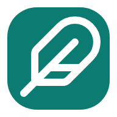
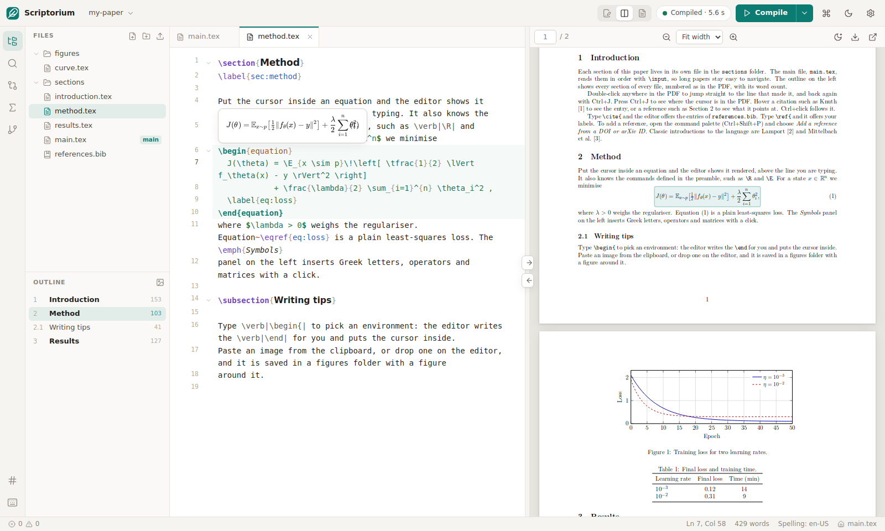
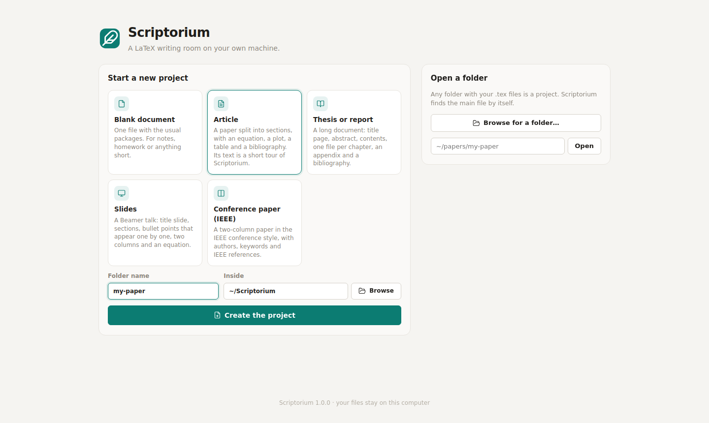
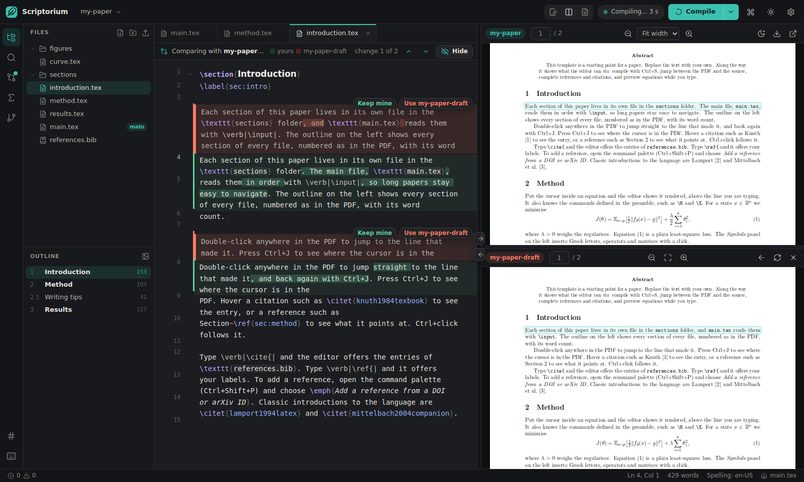
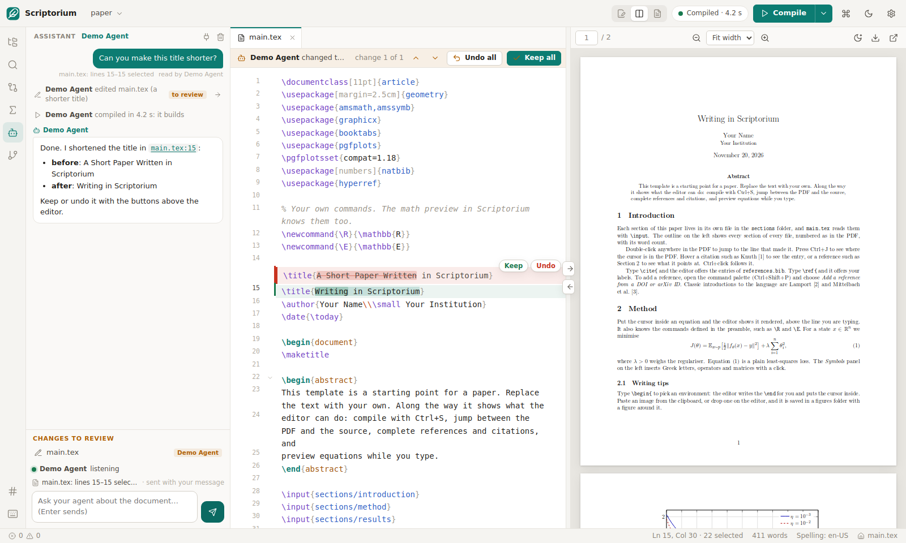

<p align="center">
  
</p>

<h1 align="center">Scriptorium</h1>

<p align="center"><b>A LaTeX writing room on your own machine.</b><br>
Source on the left, PDF on the right, everything on your computer. No account, no upload, no limits.</p>

<p align="center"></p>

If you have used Overleaf, Scriptorium will feel familiar. It runs in your browser, but the files, the compiler and
the PDF all stay on your computer, and it works offline once set up.

## Get started

You need **Python 3.8 or newer** (macOS and Linux already have it, on Windows get it from
[python.org](https://www.python.org/downloads/)) and a browser.

**1. Download Scriptorium**

```bash
git clone https://github.com/RocketNeurons/scriptorium.git
cd scriptorium
```

No git? Click the green **Code** button on GitHub, then **Download ZIP**, and unzip it.

**2. Install Tectonic, the LaTeX engine (once)**

Run this inside the `scriptorium` folder. It downloads a single program next to Scriptorium.

| Your system | Command |
|---|---|
| macOS | `brew install tectonic` |
| Linux, WSL, or macOS without Homebrew | `curl --proto '=https' --tlsv1.2 -fsSL https://drop-sh.fullyjustified.net \| sh` |
| Windows (PowerShell) | `iex ((New-Object System.Net.WebClient).DownloadString('https://drop-ps1.fullyjustified.net'))` |

Not sure? Skip this step: Scriptorium shows you the right command when it starts.

**3. Start it**

```bash
python3 scriptorium.py
```

(On Windows: `python scriptorium.py`.) Your browser opens. Pick a template, give the project a name, and start
writing. Press **Ctrl+S** to compile.

<p align="center"></p>

To open a paper you already have, choose **Open a folder** on that page, or start Scriptorium with its folder:

```bash
python3 scriptorium.py path/to/my-paper
```

## What it does

**Writing**
- Completion for commands, environments, `\ref` labels (with what they point at), `\cite` keys (with title and
  authors), files and images. Picking an environment writes its `\end` for you.
- A live preview of the equation under the cursor, with your own `\newcommand`s.
- A palette of math symbols drawn as math: click to insert.
- Hover a citation, reference or image to see it. Ctrl+click follows it.
- Your browser's spell checker, which skips commands, math and labels.

**PDF**
- Compiles in a few seconds and keeps its place in the PDF.
- Double-click the PDF to jump to the source line. Ctrl+J shows the cursor's place in the PDF.
- Errors appear under the line that caused them, with a plain-language hint.

**References**
- **Add a reference from a DOI or arXiv ID**: Scriptorium fetches the BibTeX, adds it to your `.bib` file and puts
  `\cite{...}` at the cursor.
- Undefined `\ref` and `\cite`, missing files and unclosed environments are marked as you type.

**Long documents**
- An outline of all sections across files, numbered as in the PDF, with word counts.
- Search and replace across files. Ctrl+P opens any file, section, label or citation.
- Paste or drop an image to save it and insert a figure. Insert a booktabs table in two clicks.

**Versions**
- **Compare with another version** of the paper: its text appears inline where it differs, with "keep mine" and
  "use theirs" buttons, and its PDF opens below yours.
- If the folder is in git: changed lines are marked, and you can see diffs and commit from the sidebar.

<p align="center"></p>

**Your AI agent, in the editor**
- Chat with your own AI agent from the **Assistant** panel: Claude Code, Codex, Cursor, a script around a local model,
  anything. See [Talk to your AI agent](#talk-to-your-ai-agent) below.

**Comfort**
- Light and dark themes, dark PDF pages, autosave, and reloading of files changed by other programs.
- Install it as an app (Edge: menu, Apps, Install this site as an app. Chrome: the install icon in the address bar)
  to give it its own window and a Start menu or Dock entry.

## Talk to your AI agent

Scriptorium does not run a model and never asks for an API key. Instead it opens a **door** on your computer, and
the agent you already use comes in through it, with its own login. Through the door the agent sees what you are
looking at (file, cursor, selection, errors), reads what you write in the **Assistant** panel, answers there, edits
the document and compiles it. Every edit appears in the editor as a change you **keep** or **undo**.

1. Open the **Assistant** panel (the robot icon, or Ctrl+Shift+A). It shows how to connect, with your private address.
2. Connect your agent, once:

   | Agent | How |
   |---|---|
   | Claude Code | run the `claude mcp add ...` line from the panel in a terminal |
   | Codex, Cursor, other MCP apps | add the MCP server address from the panel (streamable HTTP) |
   | Any agent with a terminal | paste it the sentence from the panel: it reads the instructions with `curl` |

3. Tell your agent: **"Listen to me in Scriptorium."** Then write in the panel. Select a passage first to ask about
   it ("make this shorter", "check this proof", "add a citation for this claim").

<p align="center"></p>

The door is plain HTTP and MCP on `localhost`, protected by a key that only the panel shows. Agents get these tools:
`wait_for_message`, `send_message`, `set_status`, `get_context`, `list_files`, `read_file`, `edit_file`,
`write_file`, `compile` and `show_location`. The full instructions an agent receives are at `/agent` (open the
address from the panel to read them).

## Keyboard shortcuts

| Keys | Does |
|---|---|
| Ctrl+S | Save and compile |
| Ctrl+Enter | Compile |
| Ctrl+P | Go to a file (type `>` for commands, `@` sections, `#` labels, `&` citations) |
| Ctrl+Shift+P | All commands |
| Ctrl+J | Show the cursor's place in the PDF |
| Double-click the PDF | Jump to the source |
| Ctrl+Space | Complete a command, label or citation |
| Ctrl+B / Ctrl+I | Bold / emphasis |
| Ctrl+/ | Comment lines in or out |
| Ctrl+F / Ctrl+Shift+F | Find in the file / in all files |
| F12 or Ctrl+click | Follow a `\ref`, `\cite`, `\input` or image |
| F7 / Shift+F7 | Next / previous difference when comparing or reviewing |
| Ctrl+Shift+A | Talk to your AI agent |

On a Mac, use Cmd instead of Ctrl.

## Questions

**The first compile is slow.** Tectonic downloads the LaTeX packages a document needs the first time it sees them.
After that, compiles take a few seconds.

**Does my paper leave my computer?** Not through Scriptorium. It only goes online to download its editor libraries
once, to let Tectonic fetch LaTeX packages, and to look up a DOI or arXiv ID when you ask it to. If you connect an AI
agent, that agent sends what it reads to its own provider, as it always does.

**Where does the PDF go?** Into a cache folder, so your project folder stays clean. The download button above the PDF
saves a copy wherever you like.

**Where are deleted files?** In Scriptorium's trash folder. The message after deleting shows where.

**Port 8765 is busy.** Scriptorium takes the next free one, or choose one with `--port 9000`.

**Windows with WSL.** Run Scriptorium inside WSL and it opens your Windows browser.

**Can it use TeX Live instead of Tectonic?** Not yet. Tectonic is used because it is one small program that installs in
one line and fetches packages by itself.

## Options

```text
python3 scriptorium.py [folder] [--main file.tex] [--port 8765] [--no-open] [--version]
```

## How it is made

A small Python server (standard library only, no `pip install`) and a web page. The page uses
[CodeMirror 6](https://codemirror.net/) for the editor, [pdf.js](https://mozilla.github.io/pdf.js/) for the PDF,
[KaTeX](https://katex.org/) for the math preview and [Lucide](https://lucide.dev/) icons. They are downloaded the first
time and kept in a cache. There is no build step: edit a file, reload the page.

| File | What is in it |
|---|---|
| `scriptorium.py` | The server: projects, Tectonic, error messages, git, templates |
| `synctex.py` | The jumps between the PDF and the source |
| `door.py` | The agent door: MCP and HTTP tools for AI agents, the conversation |
| `templates/` | The starting projects on the welcome page (add your own: a folder with a `template.json`) |
| `web/js/main.js` | The app: files, tabs, outline, search, compiling, comparing, settings |
| `web/js/editor.js` | The editor: LaTeX highlighting, completion, hovers, math preview, checks |
| `web/js/latex.js` | Reading LaTeX: sections, labels, citations, math, word counts |
| `web/js/pdfview.js` | The PDF pane |
| `web/css/app.css` | The look, with light and dark colours |

The server only answers on your own computer (127.0.0.1), and other web pages cannot write files through it.

## License

MIT. See [LICENSE](LICENSE). CodeMirror and KaTeX are MIT, pdf.js is Apache-2.0, Lucide is ISC, Tectonic is MIT.
